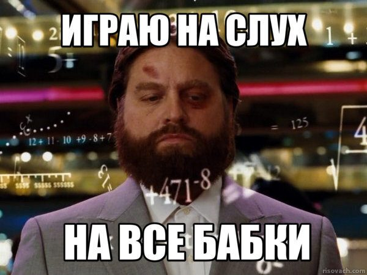

«Играешь на слух? Ну, это когда пальцем по клавишам тычешь, пока не попадёшь?».

Примерно так в обществе понимают игру на слух — и потому записывают её в баловство: не настоящее музицирование, а «детишки ковыряются». Настоящим считается серьёзное занятие — разучивать готовые ноты, написанные кем-то другим, и точно их исполнять.

Разберёмся, что там на самом деле «не настоящее».

## Откуда взялась слава халтуры

По-честному — отчасти заслуженно. Игра на слух в народном сознании — это подбор наугад: тыкать как обезьянка в ноты и слушать, оно-не оно. Что-то действительно легкомысленное — рядом с «настоящей точной работой» по разучиванию написанных кем-то нот.

Только это не игра на слух, которой я учу.

Тыканье наугад, примерно, куда-то туда — это как раз отсутствие внутренней работы, или она неточная, недоделанная: человек не анализирует мелодию внутри до полной уверенности и ищет её на ощупь. А тот, кто действительно точно играет на слух, — мелодию слышит и понимает нотами точно — до того, как сыграть её. Пальцы просто переносят наружу то, что уже готово и проверено в голове.

Поэтому в «ноты» верят, а «на слух» — нет. Потому что не умеют

Обучение по нотам более-менее понятно и знакомо людям: вот ноты на бумаге, вот они на инструменте, играй каждую как написано — и будет результат. Понятный, наглядный, элементарный процесс — примитивный даже.

А вот как можно точно играть на слух — люди вообще не представляют.

Не представляют — значит, не существует. Ну или «талант». Отсюда и налёт несерьёзности: понятное дело — настоящее, непонятное — халтура.

Но всё ровно наоборот. Сейчас покажу, что там непонятно.

## Что происходит в голове, когда играешь по нотам

- Видишь закарлючку (ноту).
- Понимаешь, куда и как долго жать на инструменте.

**Играешь, добавляя на своё усмотрение только громкость, штрихи и другие нюансы.**

## Что происходит в голове, когда человек играет на слух точно, уже умея это делать

**Услышать то, что не звучит в реальности.**

Сначала нужно воспроизвести в голове мелодию, которую когда-то слышал — разобрать её без звука, опираясь на свои нейронные связи, на память о ней. И не «примерно помню напев», а настолько точно и помнить её, и понимать, что чувствуешь, чтобы самому написать себе ноты в моменте, только тоже — без написания.

**Разложить распознанную музыку нотами в реальном времени.**

Быстро, как современный ИИ: не сесть заранее, записать ноты, проверив каждую, и потом выучить записанное — а сразу перекладывать мелодию на инструмент, по ходу игры, без черновика.

**Играть, продолжая анализировать и распознавать дальше.**

Одновременно-попеременно вспоминать звучание, анализировать его, понимать нотами — и играть.

И при этом желательно показывать лёгкость, ведь для зрителя хочется видеть тебя не замеревшим в напряжении этого мысленного конвейера, а лёгким, игривым: двигаться, пританцовывать, общаться с аудиторией взглядом, взаимодействовать с танцующими и развлекающимися людьми — которые ещё и часто находятся в состоянии алкогольного опьянения и непредсказуемы в поступках и движениях.

Такой конвейер в голове работает — а ты ещё и танцуешь. А уткнувшись в ноты сидят как раз те, кто проделывает гораздо более лёгкую работу в голове.

Но и удовольствия они получают настолько же меньше — вот почему играя на слух ещё и приплясывать хочется и общаться свободными глазами, хоть это и гораздо энергозатратнее.

## ЧТО и КАК

У исполнителя по нотам инструкция уже написана — его задача сводится только к тому, чтобы эту инструкцию элементарно исполнить. Красиво исполнить — это мастерство, не умаляю. Но играя на слух, в итоге нужно сделать то же самое, не хуже.

То есть ноты — это ЧТО сыграть, а КАК — это уже исполнитель решает.

А на слух надо ещё и додуматься сперва, ЧТО сыграть, а потом и КАК.

Чтобы разобранное по нотам сыграть, как будто сам придумал или на слух играешь, без шпаргалки перед носом — нужно запомнить элементарную двигательную последовательность и повторить её уже без нот.

## В итоге

Настоящая игра на слух — это не отсутствие работы. Это работа, которую нельзя увидеть. Поэтому в неё и не верят.

Её можно только почувствовать на себе. И я даю эту возможность каждому желающему.
